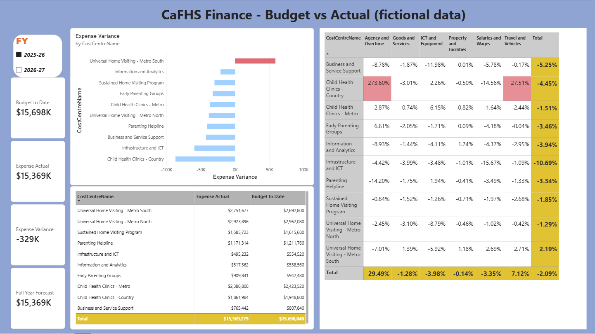

# Power BI Portfolio

Power BI dashboards by Himanshu Muley. Each project folder holds the .pbix file, its source data, screenshots and a README explaining the business question, the data model and the DAX.

| Project | What it covers | Status |
|---|---|---|
| [CaFHS Finance, FTE and Activity Dashboard](cafhs-dashboard/) | Budget vs actual, staffing and service activity across 10 cost centres of a child and family health service (fictional data) | Finance page done; FTE and Activity pages in progress |

