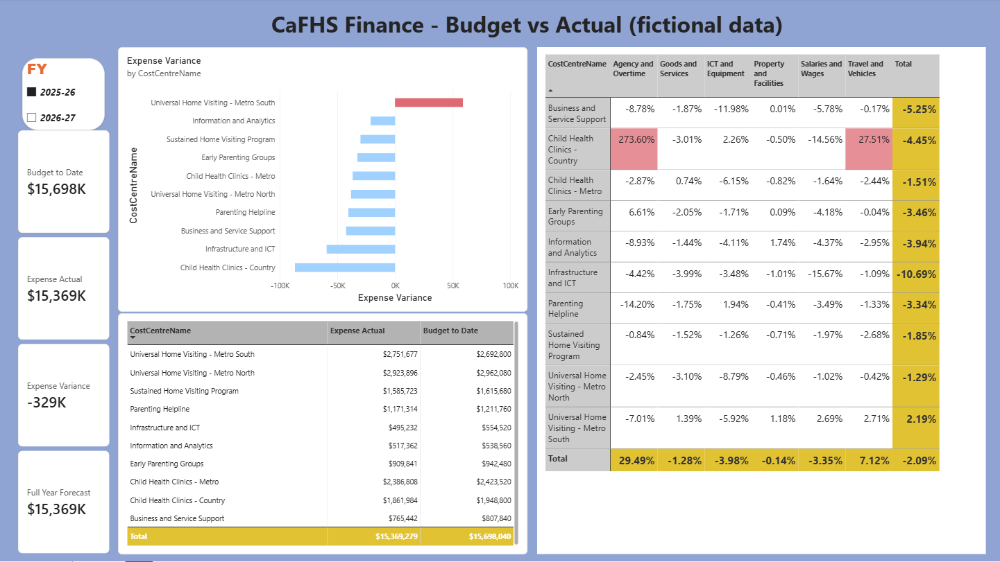

# CaFHS Finance, FTE and Activity Dashboard (Power BI)

A Power BI reporting dashboard for a child and family health service: expense budget vs actual, staffing (FTE) and service activity across 10 cost centres.

> **All data is fictional.** The cost centres, figures and register entries were made up for a portfolio exercise. They do not represent real SA Health, WCHN or CaFHS data.



## Status

| Page | Status |
|---|---|
| Finance: budget vs actual | Done |
| FTE: budget vs actual, variance register | In progress |
| Activity: performance against target | Planned |

## The business question

A business manager needs to answer three questions each month:

1. Is each cost centre spending to budget, and where is the variance coming from?
2. Are staffing levels (FTE) within budget, and is any overrun approved?
3. Are services delivering the activity they are funded for?

The Finance page answers the first. The FTE and Activity pages will answer the other two.

## Finance page

- **FY slicer** for 2025-26 or 2026-27 (financial years run July to June)
- **KPI cards:** Budget to Date, Expense Actual, Expense Variance, Full Year Forecast
- **Bar chart:** expense variance by cost centre, with overspend highlighted
- **Table:** actual vs budget to date by cost centre
- **Matrix:** variance % by cost centre and expense account, with large overspends flagged

### What it shows (FY 2025-26)

- **Overall:** the service is $329K (2.1%) under budget, at $15.37M actual against $15.70M budget.
- **Universal Home Visiting - Metro South** is the only cost centre over budget, by about 2.2% ($59K).
- **Child Health Clinics - Country looks underspent (-4.5%), but the total hides a problem.** Agency and overtime is 274% over budget and travel is 28% over. Vacancy savings in salaries offset them. Looking only at the total variance would miss it.
- **Infrastructure and ICT** has the largest underspend (-10.7%). An equipment refresh is budgeted in a different month from when it's bought, so most of this is a timing variance rather than a real saving.

## Data model

Star schema built from `data/CaFHS_Mock_Finance_FTE_Activity.xlsx`. Each sheet is a named Excel table.

| Table | Type | Grain |
|---|---|---|
| `DimCostCentre` | Dimension | 10 cost centres, with service stream and region |
| `Date` | Dimension (DAX) | Daily calendar, Jul 2025 to Jun 2027, with month, FY and FY month number |
| `FactFinance` | Fact | Monthly budget and actual ($) by cost centre and account (1,776 rows) |
| `FactFTE` | Fact | Monthly budget and actual FTE by cost centre (240 rows) |
| `FactActivity` | Fact | Monthly activity target and actual by cost centre (168 rows) |
| `FTEVarianceRegister` | Fact | Approved and pending FTE variance requests |

- Every fact table relates to `DimCostCentre` on `CostCentreCode`, and to `Date` on `Month` (one-to-many, single direction).
- Fact tables never join directly to each other.
- Key columns in the fact tables are hidden, so visuals always use the dimensions.
- Budgets cover all 24 months. Actuals run to September 2026, which gives the year-to-date and forecast measures something to work with.

## Key DAX measures

Measures are kept in a separate `_Measures` table.

```DAX
Last Actual Month =
CALCULATE ( MAX ( FactFinance[Month] ), REMOVEFILTERS (), NOT ISBLANK ( FactFinance[Actual] ) )

Expense Actual =
CALCULATE ( SUM ( FactFinance[Actual] ), FactFinance[AccountType] = "Expense" )

Budget to Date =
VAR LastM = [Last Actual Month]
RETURN CALCULATE ( [Expense Budget], KEEPFILTERS ( 'Date'[Date] <= LastM ) )

Expense Variance = [Expense Actual] - [Budget to Date]

Expense Variance % = DIVIDE ( [Expense Variance], [Budget to Date] )

Full Year Forecast =
VAR LastM = [Last Actual Month]
RETURN [Expense Actual] + CALCULATE ( [Expense Budget], KEEPFILTERS ( 'Date'[Date] > LastM ) )
```

Design choices:

- **Variance is measured against budget to date, not the full-year budget.** Otherwise months with no actuals yet make every cost centre look underspent.
- **Positive variance means overspend**, matching how a finance team reads it.
- **The forecast is actuals so far plus the remaining budget.** It's a simple, explainable method that suits monthly reporting.

## How to open it

1. Install [Power BI Desktop](https://powerbi.microsoft.com/desktop/) (free, Windows only).
2. Open `cafhs_finance_dashboard.pbix`. The data is already loaded in the file.
3. To refresh from the source, point the data source at `data/CaFHS_Mock_Finance_FTE_Activity.xlsx` in **Transform data → Data source settings**.

## Repository contents

```
cafhs_finance_dashboard.pbix          Power BI report and model
data/CaFHS_Mock_Finance_FTE_Activity.xlsx   Fictional source data (README tab explains it)
screenshots/finance_page.png          Finance page
```

## Next

- **FTE page:** budget vs actual FTE by month, FTE variance by cost centre, and a check of overruns against the variance register to flag unapproved variance.
- **Activity page:** activity as a % of target by month and cost centre.

Tools: Power BI Desktop, DAX, Power Query, Excel.
